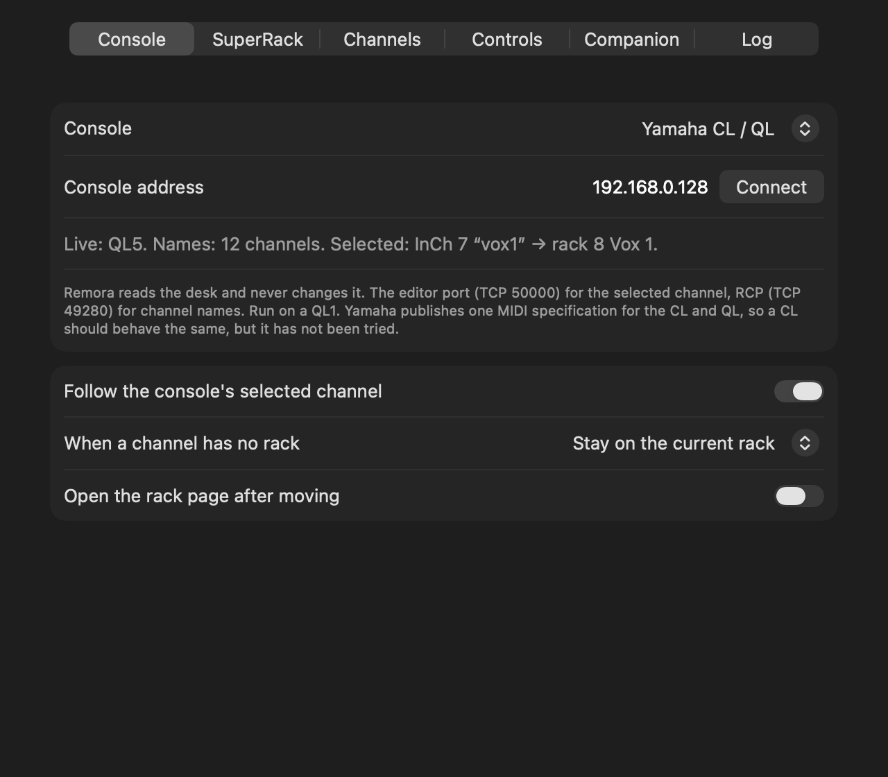
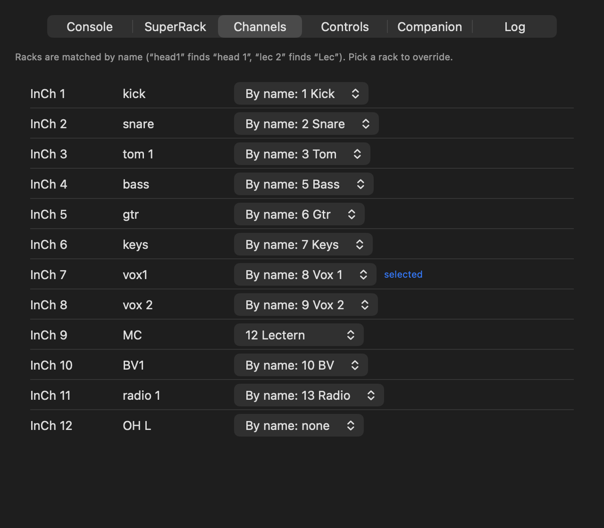
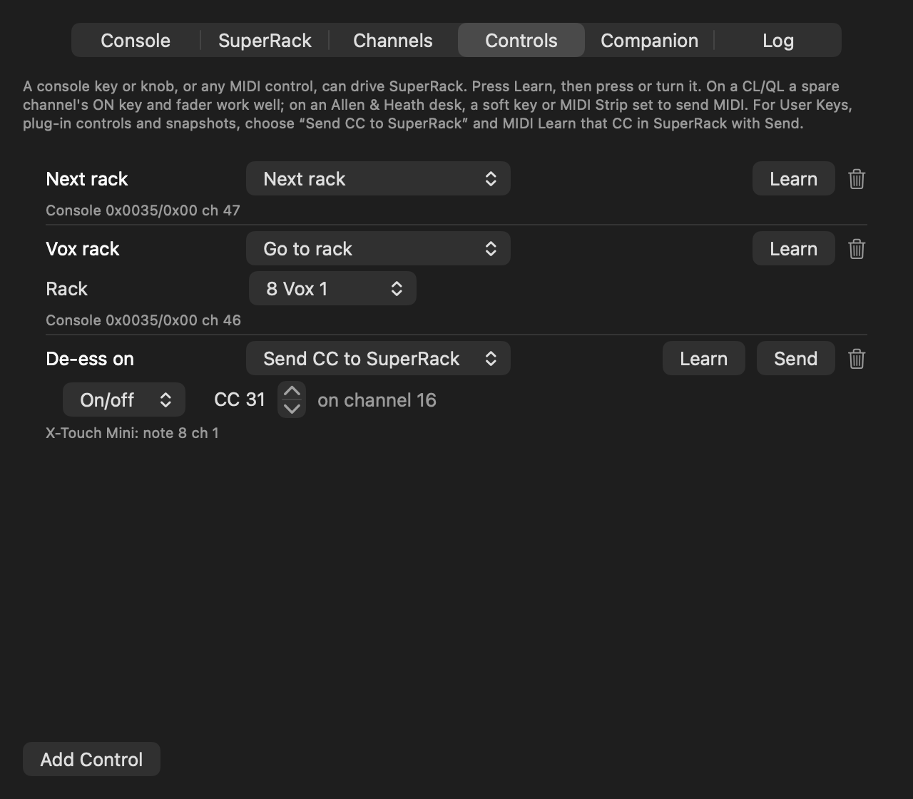

# Remora

> **AI-assisted project.** This codebase was created with [Claude](https://claude.com/claude-code)
> (Anthropic), directed and reviewed by a human author.

A Mac menu-bar app that makes **Waves SuperRack Performer follow the desk**. Select a channel on a
Yamaha CL or QL and SuperRack goes to that channel's rack, so the plug-ins in front of you are the
ones on the channel you're working on. Desk keys, any MIDI controller and Companion can drive
SuperRack's racks, plug-ins and MIDI-learned controls too.

A remora rides along with a shark and goes wherever it goes. It does not get a say in where that is,
which is the arrangement here as well: Remora reads the desk and never changes it.

> **Status:** it's been used on a live show with a QL1 and SuperRack Performer 15.15, and run end to
> end against the same QL1 after a show. 0.3.0 adds Yamaha DM7 and DM3, and Allen & Heath Qu, SQ,
> dLive and Avantis, all experimental: built from the manuals and not yet tried on a desk. More
> Yamaha and Allen & Heath desks are coming. The full list of what has and hasn't been run is at the
> bottom.



<!-- downloads:start -->
<!-- downloads:end -->

## Desks

| Desk | Follows | Channel names | Learned controls | Status |
|---|---|---|---|---|
| Yamaha QL | the selected channel (SEL) | yes, over RCP | ON keys, faders, anything on the editor link | run on a QL1 |
| Yamaha CL | the selected channel (SEL) | yes, over RCP | as the QL | same protocol as the QL, not tried |
| Yamaha DM7, DM3 | the channel on cue, with **[CUE] > [SEL] Link** on | yes, over RCP | none yet | experimental |
| Allen & Heath Qu | the channel on PAFL, with **Sel follows PAFL** on | yes | soft keys, any MIDI the desk sends | experimental |
| Allen & Heath dLive, Avantis | no | yes | soft keys and MIDI Strips set to send MIDI | experimental |
| Allen & Heath SQ | no | no | soft keys and MIDI strips set to send MIDI | experimental |

Yamaha doesn't document a way to read the selected channel on a DM, and the Qu, SQ and dLive don't
send one either, so those desks follow cue or PAFL instead, or don't follow at all. On a desk that
can't follow, a soft key with **Go to rack** gets you to a rack in one press. Everything Remora sends
any desk is a read request; there's a check in the code that refuses to send anything else.

More Yamaha and Allen & Heath desks are on the way. If yours isn't here, or it's here and doesn't
behave, [let me know](https://stoatworks-labs.com/feedback/).

## How it works

- **The desk.** On a CL or QL the selected channel comes from the editor port (TCP 50000, the link QL
  Editor uses) and channel names from RCP (TCP 49280). A DM uses RCP alone. Allen & Heath desks use
  their MIDI over TCP (port 51325). See [docs/PROTOCOL.md](docs/PROTOCOL.md).
- **The rack.** Remora matches the channel's name to a rack name: "head1" finds "head 1", and "lec 1"
  and "lec 2" both find "Lec". The Channels tab overrides any channel by hand.
- **SuperRack.** Its MIDI offers Next and Previous Rack and nothing else, and never says which rack
  it's on. With Accessibility, Remora reads the rack's name in SuperRack's top bar and steps straight
  there. After each move it checks that SuperRack shows the rack it went to, and homes and counts once
  if not. Racks that share a name (several "n/a") can't be told apart, so from one of those, and
  without Accessibility, Remora counts: one Previous per rack lands on rack 1 from anywhere, then it
  counts Next. "Count from the last move" skips the trip to rack 1, but without Accessibility it goes
  wrong after a mouse click on a rack in SuperRack, until Resync.

### How fast a move is

SuperRack's MIDI has no "go to rack 8", only one step at a time, so a move can't be truly instant.
What Remora can do is make the steps few and close together. Reading SuperRack's window means a move
is only as many steps as racks between here and there, and the steps now go out 2 ms apart (it was
20 ms), which is as close as the settings allow. Across a whole 16-rack session that's about 30 ms of
MIDI. The racks in between still flash past on SuperRack's screen, briefly.

SuperRack's Racks menu has a Rack Select submenu that goes straight to a rack. It's only reachable
through the menu, by Accessibility, so it would mean Remora opening a menu on SuperRack's screen mid
show. I haven't tried it, and I'm not going to try it for the first time on a live show.

## Set up

1. Download the DMG below (signed and notarised) and drag Remora to Applications, or build it:
   `scripts/build-app.sh` → `dist/Remora.app`. Open it; a fish appears in the menu bar. macOS asks
   for Local Network access: allow it, or the desk link fails with "Network is down". A rebuilt copy
   may ask again.
2. Settings › Console: pick the desk and type its address. The fish fills in when the desk is live.
   On a dLive or SQ, set the desk's MIDI channel too.
3. In SuperRack, open Setup › MIDI Controller (the gear):
   - tick **Remora** under MIDI In;
   - **Import** the mapping from Remora's menu › Save SuperRack Mapping… (channel 16, CC 20–25 by
     default), or MIDI Learn the six navigation commands with the buttons on the SuperRack tab.
4. Optional, and worth it: give Remora **Accessibility** (System Settings › Privacy & Security ›
   Accessibility), so it reads SuperRack's rack instead of only counting. Remora never asks for it
   on its own account; Settings › SuperRack says whether it's reading.
5. Select channels on the desk.

**Start Remora before SuperRack.** SuperRack only looks for MIDI ports when it starts and when a MIDI
Controller is added, and it doesn't hear a Remora that has quit and come back. If Remora started late
or was restarted: Setup › Controllers › MIDI Controller's menu › Remove, then + › MIDI Controller,
and tick Remora again. The mappings survive; Follow Prg. Changes goes back to channel 1, so set it
back to None. Unticking and ticking Remora isn't enough. Updating Remora counts as a restart, and a
new copy may need its Accessibility switched off and on again.



## Controls

Settings › Controls: add a control, press **Learn**, then press or turn something.

- On a CL/QL, a spare channel's ON key and fader work well.
- On an Allen & Heath desk, the soft keys and MIDI Strips, set to send MIDI, come in over the desk
  link. A&H's MIDI driver and any MIDI controller work as well.
- A control can step racks or plug-ins, go to a given rack, open the rack page, go back to the
  overview, resync, or switch follow on and off.
- It can also send a CC to SuperRack for anything you MIDI Learn there: User Keys, a plug-in's
  Continuous and Discrete Controls, snapshots. **Send** fires the CC once so SuperRack's learn picks
  it up.



## Third-party plug-in windows

SuperRack docks Waves plug-ins in the rack page but opens anything else (FabFilter, De-Feedback …)
in a floating window, and leaves it there when you move to another rack, select a Waves plug-in or go
back to the overview. Settings › SuperRack › Third-party plug-in windows:

- **Close them when the rack, page or plug-in changes.** As a docked plug-in would go. Stepping
  between two third-party plug-ins SuperRack already swaps itself. A window with SuperRack's own pin
  set stays open. Also in the menu.
- **Place them over the rack page's plug-in area** as they open, so they sit where a Waves plug-in
  would. SuperRack won't let them be resized, so a wide one (Pro-Q 4) still covers the output column;
  shrink it with the plug-in's own handle.
- **Show the new rack's plug-in after a rack change.** On the Rack page SuperRack shows nothing for a
  non-Waves plug-in when the rack changes; it only does when the Rack page is opened from another
  page. So when the new rack's selected plug-in is a non-Waves one, Remora sends Back to overview and
  Open rack page, and SuperRack opens its window. The overview flashes for a moment. It waits for a
  move to settle (one bounce for a whole Remora move), and does nothing for a Waves selection, on
  other pages, or when that window is already open. It uses Remora's MIDI port, so SuperRack's MIDI
  Controller needs the mapping as for following.

Remora needs Accessibility for this, and reads SuperRack's application log for page and plug-in
changes. It presses only the window's own Close (never its Bypass) and moves windows; nothing else in
SuperRack is touched.

`Remora --plugin-windows [--place] [--reopen]` runs just this, beside the app (`--reopen` asks the
running app to do the bounce, over its OSC).

## Companion

Generic OSC to this Mac, UDP 9020:

```
/remora/rack/next   /remora/rack/prev   /remora/rack/select <number or name>
/remora/rack/open   /remora/overview    /remora/rack/resync
/remora/plugin/next /remora/plugin/prev
/remora/follow <0|1>   /remora/follow/toggle
/remora/cc <number> <value>
```

## Command line

```
Remora --racks                 the racks in SuperRack's current session
Remora --mapping               the SuperRack mapping for the saved settings
Remora --probe HOST [SECS] [--console KIND]   watch a desk's selection and names, read-only, no MIDI
Remora --headless [--host H] [--for S] [--dry-run | --through-app [PORT]]
Remora --plugin-windows [--place] [--reopen] [--watch] [--for S]   only the plug-in window guard
Remora --screenshots DIR       the settings window as PNGs, drawn off screen from demo data
Remora --film DIR              the same, a still per beat of the video
```

`tools/fake-ql.py` pretends to be a QL1 on localhost. It plays scripted SEL presses and fails if the
client sends anything but a read. `--through-app` hands the test copy's MIDI to the running Remora as
`/remora/cc`, because SuperRack doesn't hear a MIDI port that appears after it starts.

<!-- status -->
## What has been run

As of 2026-11-05 (0.3.0):

- **0.3.0, unit tests:** 70 now, all passing.
  - The Allen & Heath parsing runs on bytes built from A&H's MIDI protocol documents: running
    status, NRPN, the Qu's PAFL and names, dLive names by channel type, and a guard that fails any
    message that isn't a read request.
  - The DM's runs on RCP lines built from Yamaha's parameter lists: cue on and off, names by model.
  - A 15-rack move at the new 2 ms spacing finished in under 0.25 s against the fake SuperRack.
  - Settings files from 0.1 and 0.2 still load, learned controls and all, and a saved 20 ms spacing
    moves to 2 ms.
- **0.3.0, the screenshots and the video:** both drawn off screen by `Remora --screenshots` and
  `--film` from a made-up show, during a live show on the only Mac with SuperRack on it. Nothing
  connected to a desk or SuperRack, and no window opened. They're the app's own settings window, but
  SuperRack isn't in them.

- **Unit tests (0.2.0):** 53. They use real captures: the QL's selection messages, Allan's channel and rack
  names, SuperRack's own exported mapping (matched byte for byte), and lines from SuperRack's log. The
  driver's window reading runs against a fake SuperRack and its window: a name only one rack has, n/a,
  a renamed rack, a window that lies or will not hold still, and no reader at all (the same MIDI as
  counting, compared message for message).
- **Reading the rack, 2026-11-05, SuperRack 15.15.12.13**, with `Remora --headless --through-app`
  beside Remora.app 0.2.0 (its MIDI through the app's `/remora/cc`) and the rack field traced every
  millisecond; resting only on the two n/a racks, as a show might have been on (docs/PROTOCOL.md):
  - from head 1 to n/a in 2 messages (counting: 18), and head 1 to Lec in 8 (counting: 24);
  - from an n/a rack it homed and counted, and landed right;
  - an unseen move between the two n/a racks was caught at landing (the window said head 1), and it
    homed and landed right where counting alone stayed on head 1;
  - all 31 steps showed in the window, 4–23 ms after they were sent;
  - with the setting off: 18 and 16 messages, the counter's numbers;
  - one landing at 22:09 came up one rack short while a plug-in window was being closed; the fallback
    homed and landed right; the cause is not known.
- **Plug-in windows, 2026-11-05, SuperRack 15.15.12.13**, with `Remora --plugin-windows` beside the
  running app and SuperRack driven through its OSC (MIDI), on head 1/head 2 with PSE, De-Feedback,
  Pro-Q 4 and Pro-C 3:
  - closed: the open third-party window when PSE (Waves) was selected (65 ms after the OSC); head 1's
    windows on Next Rack to head 2; head 2's and head 1's on Next Rack to "n/a"; the window on
    Return To Overview;
  - left alone: a pinned De-Feedback through a Waves selection, a rack step and the overview; the
    window SuperRack reopened on Open Rack after the overview;
  - placed: Pro-C 3, De-Feedback and Pro-Q 4 over the plug-in area as each opened (positions read
    back; a capture of the two windows overlaid lines up);
  - SuperRack refused a resize from outside (Pro-Q 4 stayed 1350 × 842).
  - showing the new rack's plug-in (`--reopen`, the bounce sent through the running app's OSC):
    Next Rack to head 2 (Pro-C 3 selected) bounced once and SuperRack opened Pro-C 3, about half a
    second after the move; a Resync-style move to head 2 (16 Previous, 1 Next) bounced once, after
    it settled; to "n/a" (nothing selected) and to head 1 (PSE) it only closed the old window.
  - while SuperRack's window was out of sight (another Space or hidden), Accessibility listed none of
    its windows and the guard did nothing; it picked up again once SuperRack was showing.
- **End to end: a QL1 on V5.70a, Remora.app and SuperRack Performer 15.15.12.13**, after a show:
  - SEL presses on the desk streamed to Remora and each found the right rack: head1, head2, lec 1
    (→ Lec), hh2 (→ hh 2); ST IN 1L, ch 5 and ch 1 have no rack and stayed put;
  - SuperRack went to the rack: head 1 on follow, Lec on a SEL press;
  - OSC: select by name ("Lec") and by number, Next, Next at rack 16 (stayed there), Open Rack,
    plug-in Next/Previous on the rack page, Overview, Resync;
  - Resync after SuperRack had been moved elsewhere went back to the selected channel's rack;
  - a restarted Remora was not heard until the MIDI Controller was removed and added again.
- **The menu and settings window**, clicked through on a copy with a Dock icon (computer use cannot
  reach a menu-bar-only app), its MIDI read off its port:
  - menu: live status lines, Follow off/on, Go to Rack (16 Previous, then the count), Resync, Save
    SuperRack Mapping… (byte for byte SuperRack's export), Show Log (opens Console), About, Quit;
  - every tab; the SuperRack tab's Next rack button (one step); a Channels override saved and
    cleared;
  - a learned control: Learn, then a CC from a test MIDI source. As Next plug-in, a press and release
    (127, 0) sent one step; as Send CC (Press), one CC 30. Send fired the CC once. Delete worked.
  - Fixed on the way: the tabs hid behind a » button on macOS 26, labels and buttons ran off the
    window, the mapping saved as `Remora.mrrc.mrrc`, and the OSC port showed as "9,020".
- **Against a QL1 on V5.70a**, read-only: connects, sends the opening, reads the selection at connect,
  reads 64 channel names, identifies the QL1, and maps InCh 17 "head1" to rack 1 "head 1".
- **Against `tools/fake-ql.py`:**
  - follows scripted SEL presses with the right MIDI (16 Previous, then the count);
  - "no rack" channels send nothing;
  - reconnects after the heartbeat stops;
  - OSC select by name, next, follow off/on and raw CC all worked;
  - zero non-read messages.
- **SuperRack's stepping, by hand:** measured with a test MIDI port before the app existed (clamping,
  any value steps, 16-rack range, 20 ms spacing).

**Not yet run:**

- **Any desk but the QL1.** The CL, DM7, DM3, Qu, SQ, dLive and Avantis support is built from the
  makers' documents and has only met unit tests. The CL speaks the QL's protocol (one Yamaha
  specification covers both), so it ought to just work; the rest are a best reading of the manuals.
  If you have one, I'd love to hear how it goes.
- **2 ms between steps against the real SuperRack.** The new default. At 20 ms every step showed in
  SuperRack's window 4–23 ms after it was sent; at 2 ms nobody has looked yet. Remora checks where
  SuperRack landed after every move and goes again if it's wrong, but if you see moves come up short,
  raise the spacing in Settings › SuperRack.
- **The App Nap opt-out.** Remora now asks macOS not to throttle its timers (a 2 ms sleep stretched to
  66 ms in a throttled test run). That's built, not measured in the app.
- **Plug-in windows from the menu-bar app** (its toggle, menu item and Accessibility prompt): built,
  not clicked; only the headless guard has run, and the app's own bounce (its driver sending
  Back to overview and Open rack page) has not. **Mouse and touch** selections in SuperRack (only MIDI
  drove it), two copies of one plug-in on a rack, SuperRack restarting under the guard, and
  full-screen or scaled SuperRack windows (the plug-in area was measured at 1850 × 1034).

- **Learned controls from a desk key or a hardware controller.** Only a virtual MIDI source has
  been learned; the Value and On/Off modes have only unit tests.
- **"Count from the last move"** against the real SuperRack without the window (unit tests only).
- **Reading the rack:** a mouse click on a rack in SuperRack (unseen MIDI moves stood in for one),
  SuperRack's window hidden or on another Space during a move (Accessibility then lists nothing, so
  the driver should count), a rack renamed before the session reloads, and Remora.app itself reading
  it: only a copy run from Claude's shell, with Claude's Accessibility grant, has. The settings toggle
  and its status line are built, not clicked.
- **Companion** itself; OSC was tested with a script.
- The CL/QL selection numbers above MIX 24.
<!-- /status -->

## Licence

MIT. Not made or endorsed by Waves, Yamaha or Allen & Heath.
