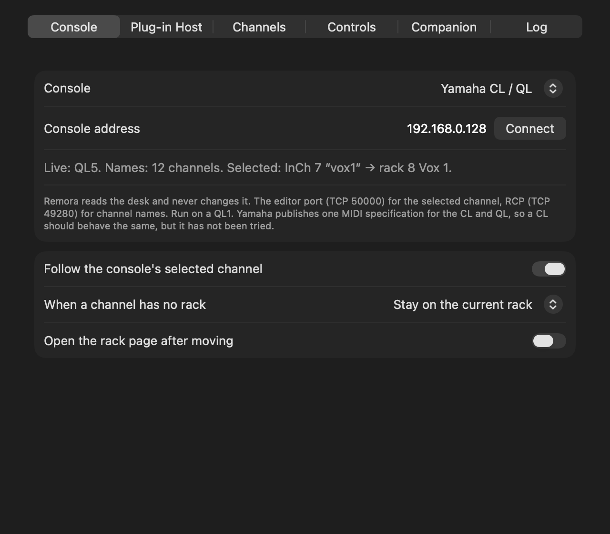
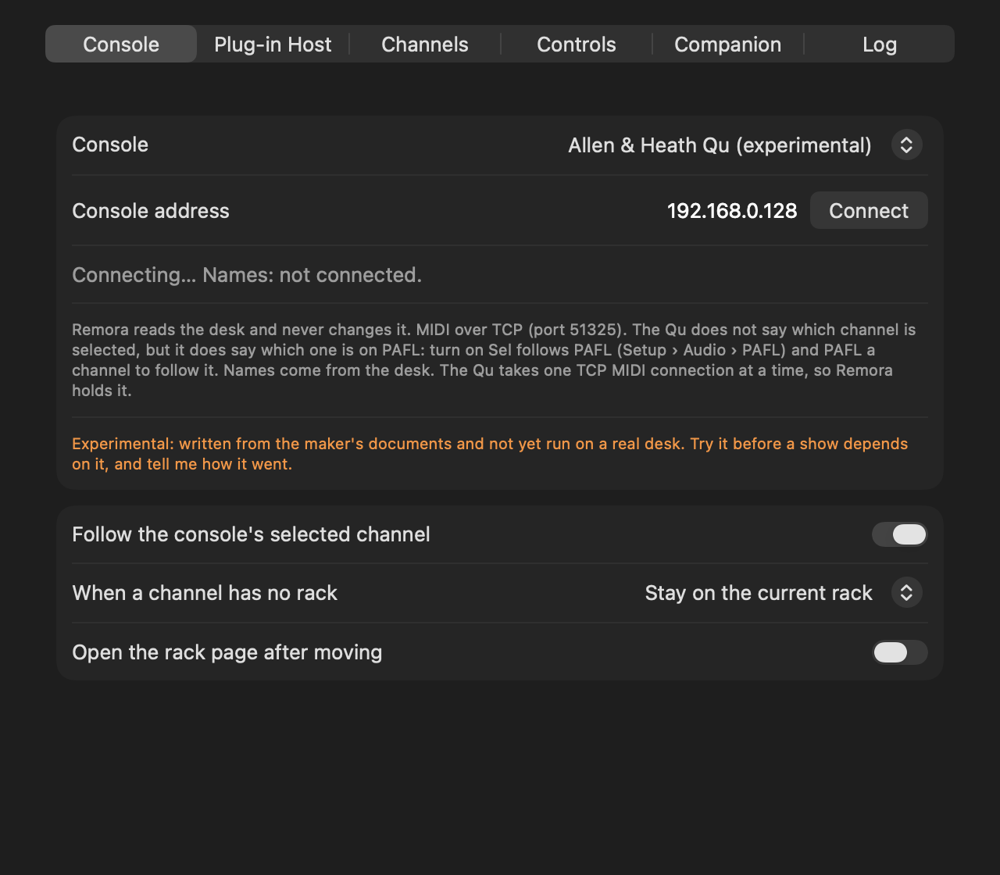
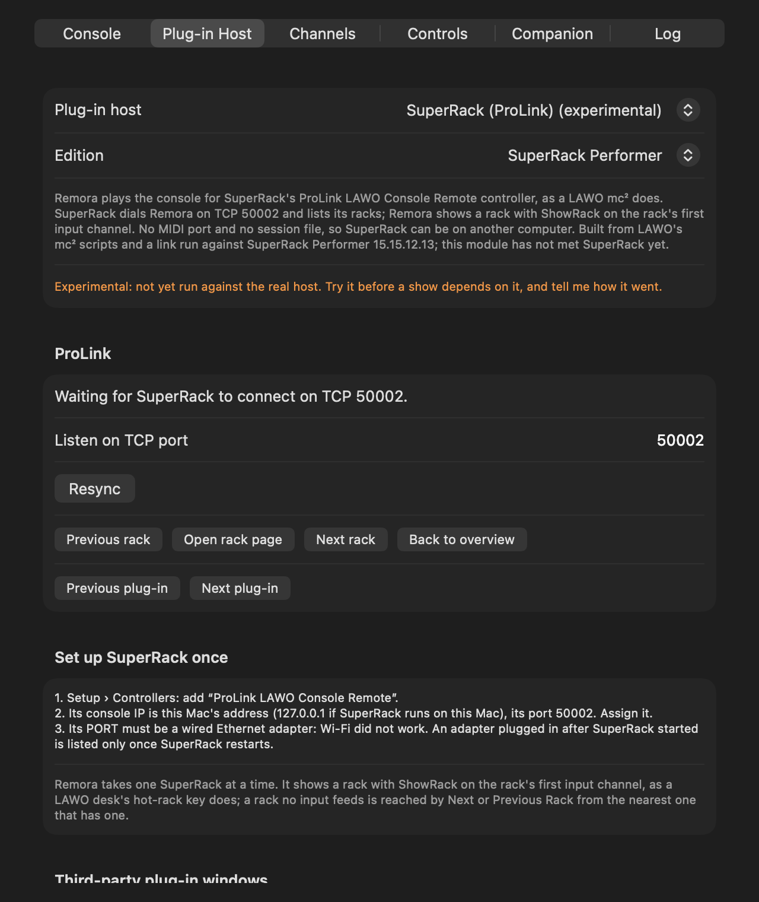
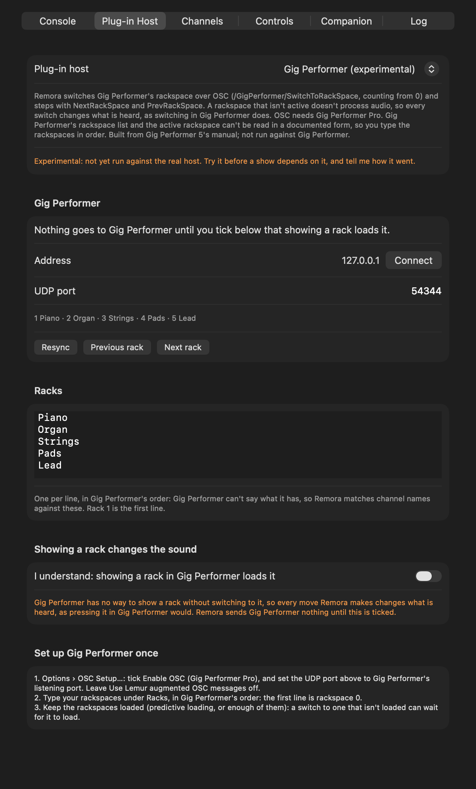
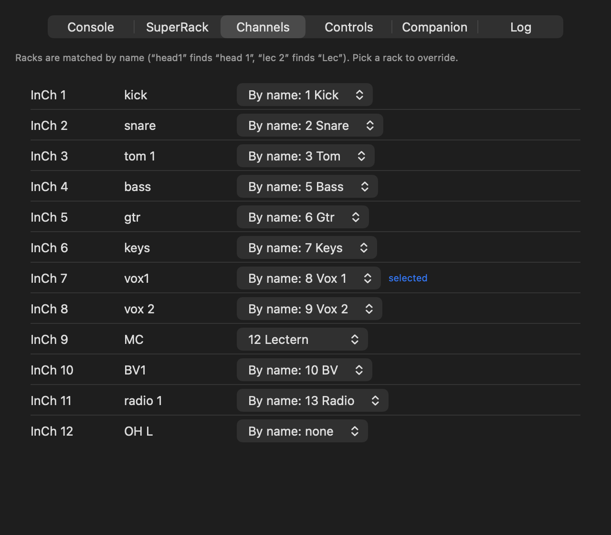
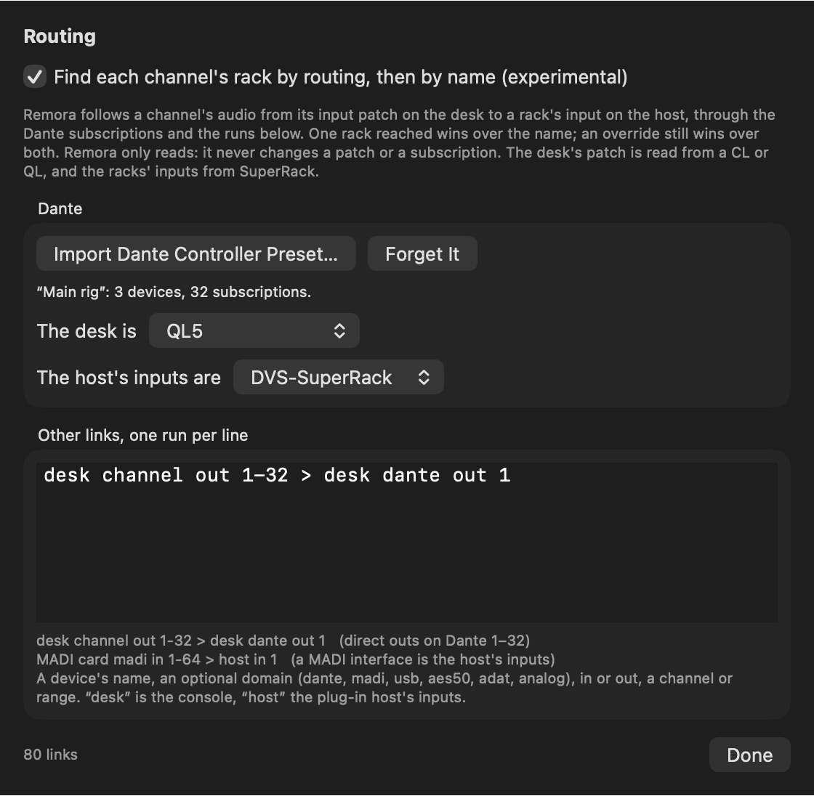
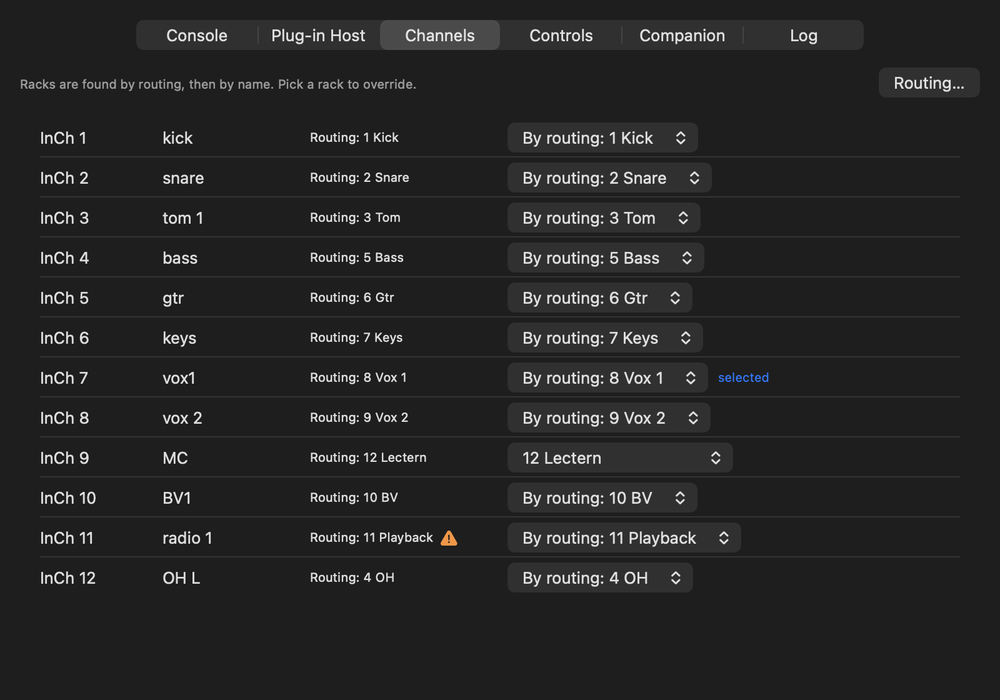
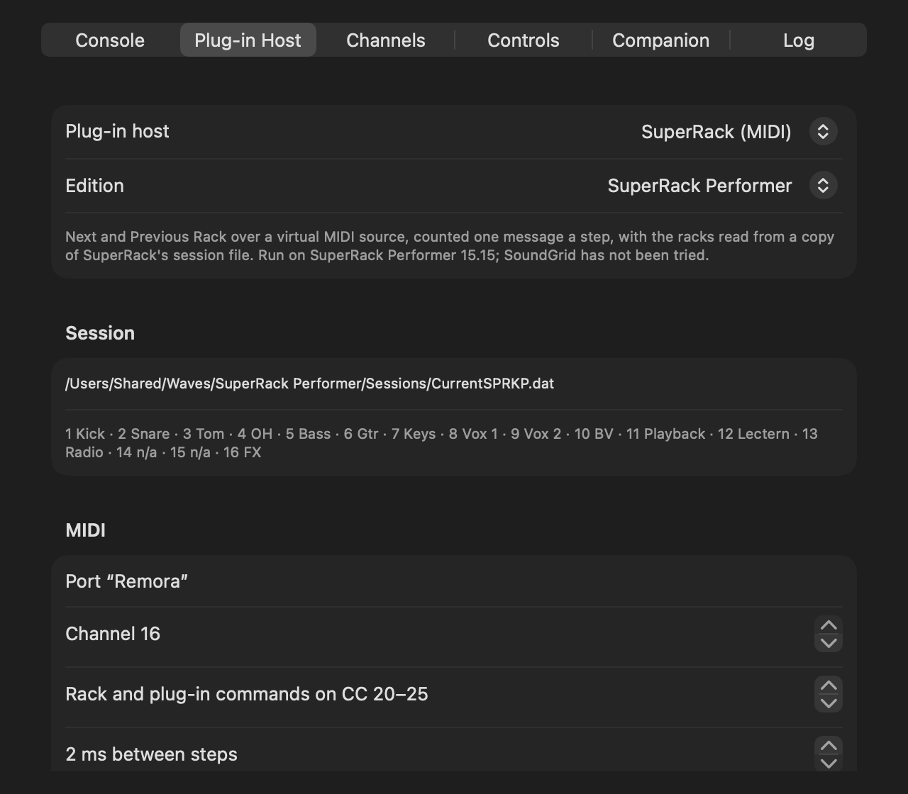
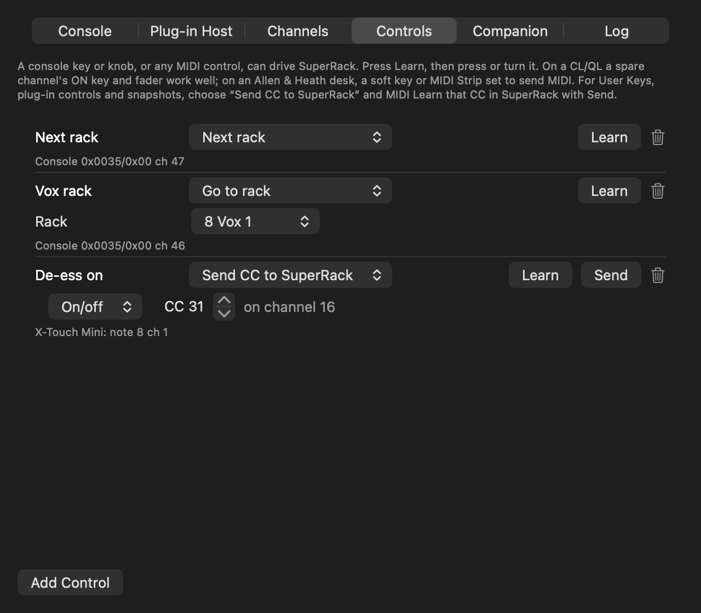

# Remora user guide

Remora is a menu-bar app for the Mac running Waves SuperRack Performer. It watches the mixing desk,
and when you select a channel it puts SuperRack on that channel's rack, so the plug-ins on screen
are the ones on the channel you're working on. It can also turn desk keys, MIDI controllers and
Companion buttons into SuperRack controls, and tidy up the floating windows SuperRack leaves lying
about for non-Waves plug-ins.

It only ever reads the desk. Nothing Remora sends a console can change a parameter, recall a scene
or press a key; there's a check in the code that refuses to send anything but a read request.

> **Where it's got to (0.3.0, 2026-11-05):** used on a live show with a Yamaha QL1 and SuperRack
> Performer 15.15, and run end to end against the same QL1 after a show. The Yamaha CL, DM7 and DM3
> and the Allen & Heath Qu, SQ, dLive and Avantis are new and experimental: built from the makers'
> documents and not yet tried on a desk. The 2 ms step spacing has been used on a live show and,
> since, traced step by step against SuperRack. Main, not yet released, adds the Yamaha RIVAGE PM,
> the Behringer X32 / Midas M32 and the Behringer Wing, and nine plug-in hosts besides SuperRack,
> all experimental too. If you try one, I'd like to hear how it went:
> <https://stoatworks-labs.com/feedback/>.



## Install

Download the DMG from the [releases page](https://github.com/stoatworks-labs/remora/releases/latest)
and drag Remora to Applications. It's signed and notarised, so it opens without a Gatekeeper warning.
It needs macOS 13 or later.

Open it and a fish appears in the menu bar. macOS asks for **Local Network** access the first time
Remora talks to the desk: allow it, or the link fails with "Network is down".

To build it yourself: `scripts/build-app.sh` makes `dist/Remora.app`.

## Connecting the desk

Settings › Console: pick the desk, type its IP address and press **Connect**. The status line says
what Remora can see: the model, how many channel names it has, and the selected channel and the rack
it found. The fish in the menu bar fills in when the desk is live.

### Yamaha CL and QL

Nothing to set on the desk. Remora connects to two ports: the editor port (TCP 50000, the same link
CL/QL Editor uses) for the selected channel, and RCP (TCP 49280) for channel names. Press SEL and
Remora follows. It's been run on a QL1 on firmware V5.70a. Yamaha publishes one MIDI specification
for the CL and QL, so a CL should behave the same, but I haven't had one to try.

Pick **Yamaha QL** for a QL and **Yamaha CL** for a CL. They're the same code; the CL's entry is
marked experimental because it hasn't met a CL. If the desk turns out to be the other kind, the
status line says so.

### Yamaha DM7 and DM3 (experimental)

Yamaha doesn't document any way to read the selected channel on a DM, so Remora follows cue instead.
On the desk, turn on **[CUE] > [SEL] Link** in Setup › Preferences, so that cueing a channel selects
it too. Then the channel you cue is the rack you get. Names come from the desk over RCP (TCP 49280).
Remora asks the desk which model it is and reads that model's channels. There are no learned
controls from a DM yet.

### Yamaha RIVAGE PM (experimental)

A PM has no one selected channel for Remora to read: its screens can show up to three. So Remora
follows cue, A or B: the channel you last put on cue is the rack you get. Names come over RCP (TCP
49280), for 288 inputs, 72 mixes and 36 matrices. Yamaha documents OSC for the PM rather than RCP;
Remora's use of RCP comes from Companion's Yamaha module, which drives PMs that way, and hasn't met a
PM yet. There are no learned controls from a PM.

### Allen & Heath Qu (experimental)

The Qu doesn't say which channel is selected, but it does say which one is on PAFL. On the desk,
turn on **Sel follows PAFL** (Setup › Audio › PAFL), then PAFL a channel to follow it. Remora talks
to the Qu's MIDI over TCP (port 51325), reads the channel names and works out the model and the
desk's MIDI channel itself. The Qu only takes one TCP MIDI connection at a time, so while Remora is
connected nothing else can use it.

### Allen & Heath dLive and Avantis (experimental)

These don't send a selected channel or PAFL over MIDI, so Remora can't follow them. It reads their
channel names, and their soft keys and MIDI Strips, set to send MIDI, come in as controls you can
learn (see Controls, below), so a soft key per rack with **Go to rack** is the next best thing. Set
the desk's MIDI channel in Remora to match Utility › Control › MIDI. Remora uses port 51325 without
TLS, so set TCP MIDI to No Security.

Pick **Allen & Heath Avantis** for an Avantis. It's the dLive's code with Avantis's channels: Remora
reads the names of inputs 1–64 (version 2.0's inputs 65–96 aren't read yet). Avantis's MIDI channel is
12 unless it's been changed. Controls learned under either entry work under the other.

### Allen & Heath SQ (experimental)

The SQ's MIDI has no channel names and no selection, so Remora can't follow it. Soft keys set to send
a MIDI note, and MIDI strips, come in as learnable controls. Set the desk's MIDI channel in Remora to
match the SQ's; the MIDI strips use the channel one above it, as the SQ does.

### Behringer X32 and Midas M32 (experimental)

Nothing to set on the desk. Remora asks it over OSC (UDP 10023) which channel is selected, five times
a second, and reads the names of the channels, aux ins, FX returns, buses, matrices and mains. It
never sends a value. It doesn't subscribe to the desk's updates either: the desk keeps only four
places for that, and X32-Edit, Companion and the like need them. If the desk stops answering for five
seconds, the status line says so and Remora keeps asking. There are no learned controls from an X32.

### Behringer Wing (experimental)

As the X32, on UDP 2223. A Wing keeps a single OSC subscription, which Remora leaves to whatever has
it. The Wing's documents don't say how it numbers the selected channel, so Remora's numbering is
worked out from the channel counts. If selecting a bus or a main lands on the wrong kind of channel,
please tell me.



## Setting up SuperRack

Settings › Plug-in Host picks how Remora drives SuperRack: **SuperRack (MIDI)**, the one that's been
used on a show, or **SuperRack (ProLink)**, experimental (below). Pick the **Edition** too:
Performer, or SoundGrid. SoundGrid keeps its app, session file and log in its own places; Remora
takes those from Waves' guide and the installed app, but it hasn't been tried with SoundGrid yet.

For SuperRack (MIDI):

1. **Start Remora before SuperRack.** SuperRack only looks for MIDI ports when it starts and when a
   MIDI Controller is added.
2. In SuperRack, open Setup › MIDI Controller (the gear) and tick **Remora** under MIDI In.
3. Load the mapping: Remora's menu › **Save SuperRack Mapping…**, then **Import** it in SuperRack's
   MIDI Controller. It's channel 16, CC 20–25 by default; change them on Remora's Plug-in Host tab if
   they clash with something. Or MIDI Learn the six navigation commands in SuperRack with the
   buttons on that tab.
4. Give Remora **Accessibility** (System Settings › Privacy & Security › Accessibility). It works
   without it, but it then has to count racks instead of reading them, which is slower and goes wrong
   if somebody clicks a rack in SuperRack. Settings › Plug-in Host says whether it's reading.

If Remora was started after SuperRack, or restarted, or updated: in SuperRack, Setup › Controllers ›
the MIDI Controller's menu › **Remove**, then + › MIDI Controller, and tick Remora again. The mappings
survive. Follow Prg. Changes goes back to channel 1, so set it back to None. Unticking and ticking
Remora isn't enough. A new copy of Remora may also need its Accessibility switch turned off and on.

### SuperRack over ProLink (experimental)

ProLink is the link a LAWO mc² desk uses to drive SuperRack. With **SuperRack (ProLink)** picked,
Remora plays the desk: SuperRack connects to Remora and lists its racks, and Remora shows a rack in
one command, on the rack's first input channel, as the mc²'s hot-rack key does. Nothing is counted
and there's no MIDI port to set up. A rack that no input feeds is reached by Next or Previous Rack
from the nearest rack that has one.

1. Settings › Plug-in Host: pick **SuperRack (ProLink)**. Remora listens on TCP 50002; change it on
   the same tab if something else has that port.
2. In SuperRack, Setup › Controllers › + › **ProLink LAWO Console Remote**. The console IP is the
   Mac running Remora (127.0.0.1 if it's the same Mac), the port Remora's. Press Assign.
3. Its **PORT** must be a wired Ethernet adapter: on Wi-Fi SuperRack didn't connect at all. An
   adapter plugged in after SuperRack started only shows up in that list once SuperRack restarts.

The Plug-in Host tab says when SuperRack has connected, and lists its racks. Remora takes one
SuperRack at a time. The plug-in window options work as they do over MIDI, except showing the new
rack's plug-in, which needs the MIDI port. A **Send CC to SuperRack** control needs SuperRack (MIDI)
too: ProLink carries no MIDI.

When you stop using ProLink, clear the controller's assignment in SuperRack. Until it connects, an
assigned controller tries again about every 750 ms, and logs each try.

The protocol comes from the scripts in LAWO's mc² firmware, and a test link was run against
SuperRack Performer 15.15 before the module was built. The module has since run against the same
SuperRack: it connected and listed the racks, and SuperRack accepted every command Remora sent. What
each did on screen hasn't been written up yet, so it's still experimental.



## Other plug-in hosts (experimental)

Remora can drive nine other plug-in hosts. Each is built from its maker's documents, and none has
been tried against the host yet.

| Host | How Remora shows a rack | Racks | Changes the sound |
|---|---|---|---|
| REAPER | selects the track, alone, through REAPER's web interface | read from REAPER | no, unless a track is set to arm when selected |
| Ableton Live | selects the track over OSC, through the free AbletonOSC script | read from Live | no |
| Logic Pro | steps with the Select Next and Previous Track key commands, learned on Remora's MIDI port | typed | can: a selected track may be ready to record |
| MainStage | a Program Change for the patch | typed | yes |
| LiveProfessor | selects the chain, over OSC | typed | no |
| Gig Performer | switches the rackspace, over OSC (Pro) | typed | yes |
| VSTHost (Windows) | loads the performance, over OSC | typed | yes |
| Cantabile (Windows) | loads the song from the set list, through Cantabile's network server | read from the set list | yes |
| Steinberg VST Live | Select Song, a MIDI action | typed | yes |

Pick one in Settings › Plug-in Host. Its settings appear below, with a **Set up … once** list at the
bottom that says what to switch on in the host.

- **Address and port:** a host Remora reaches over the network can be on another computer: the OSC
  hosts, REAPER and Cantabile. Type its address, or 127.0.0.1 for this Mac, and press Connect.
  REAPER's port is its web interface's (8080 in REAPER's guide), Cantabile's its network server's
  (35007). Ableton Live answers on a second port, 11001 unless you change it, which nothing else on
  this Mac may be using.
- **Racks:** Ableton Live, REAPER and Cantabile say what they have: Live's and REAPER's tracks, and
  the songs in Cantabile's set list, without its breaks. For the rest, type the racks under Racks,
  one per line, in the host's order: the first line is the host's first patch, chain, rackspace,
  performance or song. Channel names are matched against these as they are against SuperRack's
  racks.
- **Where the host is:** Ableton Live, REAPER, Cantabile and VSTHost say which track, song or
  performance is current; REAPER is asked every second, and with several tracks selected the first
  counts. The others don't, so Remora goes by what it last sent: pick something in the host itself
  and Remora doesn't know. Logic is counted: Remora first steps back once for every typed track,
  which reaches the first track from anywhere, and counts from there. Resync does that again.
- **Showing a rack changes the sound:** MainStage, Gig Performer, VSTHost, Cantabile and VST Live
  can only show a rack by loading it, so every move changes what's heard, as switching in the host
  would. Logic's selected track may be ready to record, and takes live MIDI. For these, Remora sends
  nothing until you tick **I understand** on the tab (it doesn't even connect to Cantabile), and
  picking one turns Follow off; turn it back on in the menu when you're ready. Remora never sends
  one the rack it knows the host is on, which could load it again.
- **REAPER:** Remora shows a track by selecting it alone, as clicking it does. With REAPER set to
  open a track's FX when the selection changes (the set-up list says where), that shows its
  plug-ins. Selecting doesn't change the sound unless the track arms for recording when selected:
  leave that off. Leave the web interface's username and password empty: Remora sends none, and the
  tab says so if REAPER asks for them.
- **What's never sent:** each host has a list of the messages Remora may send it, checked before
  every send. Nothing on any list changes a fader, a mute, a plug-in, a parameter or the transport,
  or saves anything.
- **SuperRack only:** tidying plug-in windows, the plug-in steps, Overview and a learned control's CC.
  With another host they're logged once and dropped.



## How a channel finds its rack

Remora matches the channel's name on the desk to a rack's name in SuperRack, ignoring case,
spaces and punctuation: "head1" finds "head 1" and "vox 2" finds "Vox 2". A channel that's a rack's
name plus a number finds that rack when no other rack has the name, so "lec 1" and "lec 2" both find
"Lec". Racks called "n/a", or nothing, are never matched. The Channels tab lists every named channel beside the rack it found, and marks the
selected one. Pick a rack there to override a channel by hand (the MC's mic sharing the lectern's
rack, say).

When a channel has no rack, Remora can leave SuperRack where it is or go back to its overview
(Settings › Console). "Follow the console's selected channel" switches following off without disconnecting;
it's in the menu too.



### Following the routing (experimental)

Instead of the name, Remora can follow a channel's audio: from the desk's input patch, through the
Dante subscriptions and any other links you tell it about, to the rack that input feeds in
SuperRack. When that reaches exactly one rack, it wins over the name; an override still wins over
both. It's off until you turn it on, and it only reads: Remora never changes a patch or a
subscription.

1. Settings › Channels › **Routing…**, and tick **Find each channel's rack by routing, then by
   name**.
2. In Dante Controller, File › Save Preset. In Remora, **Import Dante Controller Preset…**, then pick
   which of its devices is the desk and which is the host's inputs (Dante Virtual Soundcard on the
   SuperRack Mac, say). Remora doesn't read Dante live, so import the preset again after changing
   subscriptions.
3. Type the rest of the routing as runs, one per line: a device's name, an optional domain (dante,
   madi, usb, aes50, adat, analog), in or out, then a channel or a range. "desk" is the console,
   "host" SuperRack's inputs.
   - `desk channel out 1-32 > desk dante out 1`: direct outs 1–32 on the desk's Dante outputs 1–32.
   - `MADI card madi in 1-64 > host in 1`: a MADI interface whose inputs are SuperRack's.

Where the facts come from:
- **The desk's patch** is read from a CL or QL, for input and ST IN channels. Only Dante inputs are
  understood so far: a channel patched to anything else falls back to its name. Other desks' patches
  can't be read, but a direct out typed as a run works with any desk.
- **The racks' inputs** come from SuperRack's session file over MIDI (Remora reads its own copy), or
  from the rack list over ProLink.

On the Channels tab, routing's answer sits beside each channel, with the path it followed when you
hover over it. A ⚠︎ marks a channel where routing and the name pick different racks, and the picker
says which won ("By routing: 11 Playback"). "Routing: 2 racks" means it reached more than one, so the
name decided.





## How fast a move is

SuperRack's MIDI has no "go to rack 8". It has Next Rack and Previous Rack, one step a message, and
it never says which rack it's on. So Remora reads the rack's name in SuperRack's top bar, works out
how many steps it is from there, and sends them 2 ms apart. Across a 16-rack session that's about
30 ms of MIDI. The racks in between still flash past on SuperRack's screen.

After every move Remora reads the window again. If SuperRack isn't on the rack it should be, Remora
goes back to rack 1 and counts, once. Racks that share a name (several "n/a") can't be told apart, so
from one of those it counts too.

Without Accessibility it always counts: "Back to rack 1 first, every time" is safe whatever anyone
clicks; "Count from the last move" is quicker, but a mouse click on a rack in SuperRack throws it
until you press **Resync**.

The 2 ms spacing is new in 0.3.0, and it's the floor: traced against SuperRack, every step at 2 ms
arrived, and at 1 ms some didn't. If moves come up short, raise "ms between steps" on the Plug-in
Host tab.

SuperRack comes to the front whenever it takes a command from Remora, so the keyboard goes to it
every time the desk moves it. Mind where ⌘Q lands.



## Controls

Settings › Controls turns any key, knob or fader into a SuperRack control. Add a control, press
**Learn**, then press or turn the thing.

- On a CL or QL, a spare channel's ON key and fader work well, over the desk link.
- On an Allen & Heath desk, soft keys and MIDI Strips set to send MIDI come in over the desk link.
- Any MIDI controller on the Mac works, and so does A&H's MIDI driver.

Each control can step racks or plug-ins, **Go to rack** (pick the rack), open the rack page, go back
to the overview, resync, or switch following on and off. **Send CC to SuperRack** passes a CC on for
anything you MIDI Learn in SuperRack itself: User Keys, a plug-in's controls, snapshots. Press
**Send** to fire it once while SuperRack is learning.



## Third-party plug-in windows

SuperRack docks Waves plug-ins in the rack page, but anything else opens in a floating window and
stays open when you move to another rack. With Accessibility, Remora can:

- **close them** when the rack, page or plug-in changes, as a docked plug-in would go (a window with
  SuperRack's pin set stays);
- **place them** over the rack page's plug-in area as they open (SuperRack won't let them be resized,
  so a wide one still covers the output column);
- **show the new rack's plug-in** after a rack change, by sending Back to overview and Open rack
  page (over MIDI only), which is what makes SuperRack open it. The overview flashes for a moment.
  0.3.0 did nothing here at the default 2 ms, as SuperRack ignores the overview when the rack page
  follows that fast; 0.3.1 waits 0.1 s after a page change, so it works at the default spacing;
- **hide SuperRack while another app is in front** (0.3.1). Otherwise its plug-in windows sit
  over every other app. When you switch away with one open, Remora hides SuperRack the way ⌘H does;
  the audio carries on. Switch back to SuperRack, or move the desk, and it's all back.

It reads SuperRack's application log to know when the page or plug-in changes, and only ever presses
a window's own Close button (never Bypass) or moves it.

## Companion

Remora listens for OSC on UDP 9020. Use Companion's Generic OSC module, pointed at the Mac:

```
/remora/rack/next   /remora/rack/prev   /remora/rack/select <number or name>
/remora/rack/open   /remora/overview    /remora/rack/resync
/remora/plugin/next /remora/plugin/prev
/remora/follow <0|1>   /remora/follow/toggle
/remora/cc <number> <value>
```

## When it doesn't follow

- **The fish stays hollow:** the desk isn't connected. Check the address, that the Mac and desk are
  on the same network, and that Remora has Local Network access (System Settings › Privacy &
  Security › Local Network).
- **The status line shows the channel but SuperRack doesn't move:** SuperRack can't hear Remora.
  Remove and re-add the MIDI Controller, as above, and check the mapping is loaded.
- **It moves, but to the wrong rack:** look at the Channels tab to see what the name matched, and
  override it. If SuperRack is a rack or two off, give Remora Accessibility, or press Resync.
- **Routing picks a rack you didn't expect, or none:** hover over its answer on the Channels tab to
  see the path it followed. If the Dante subscriptions have changed, import the preset again.
- **A Qu won't connect:** something else has its TCP MIDI connection. Only one at a time.
- **A dLive won't connect:** TCP MIDI security has to be No Security for Remora.
- **An X32 or Wing says "no answer from the desk":** check the address, and that nothing between the
  Mac and the desk blocks UDP 10023 (X32) or 2223 (Wing).
- **SuperRack (ProLink) never connects:** the controller's PORT has to be a wired Ethernet adapter,
  and its console IP and port have to be Remora's. If another program has the port, the Plug-in Host
  tab says so.
- **Another host doesn't move:** the Plug-in Host tab says why. A host that changes the sound gets
  nothing until it's ticked. An OSC host needs OSC switched on, on the port Remora sends to; a MIDI
  host has to be listening to Remora's MIDI port, on Remora's channel. REAPER needs its web interface
  on, with no username or password, and Cantabile its network server, each on the tab's port.
- **Logic lands on the wrong track:** Remora counts, so a track picked in Logic, or a folder opened
  or closed, throws the count. Press Resync.
- Menu › **Show Log** opens Remora's log in Console.

## What has been tested

On a QL1 (V5.70a) and SuperRack Performer 15.15.12.13: following SEL presses, channel names, name
matching, the plug-in window guard, the OSC commands, learned controls from a virtual MIDI source,
and the restart behaviour above. Reading the rack from SuperRack's window was traced message by
message against the real SuperRack at 20 ms spacing, and since at 2 ms. Hiding plug-in windows has
only met unit tests so far.

SuperRack over ProLink: before the module was built, a test link was run against SuperRack Performer
15.15.12.13. It connected, read the rack list and showed a rack; SuperRack answered Next and Previous
Rack, but where they went wasn't watched. The module then ran against the same SuperRack, and
SuperRack answered all 27 commands Remora sent; what each did on screen isn't written up yet. SuperRack
SoundGrid hasn't been tried.

Routing has met unit tests, a simulated QL and a preset Dante Controller saved (an example published
by DanteArchitect). It hasn't read a real desk's patch, or run in the app.

The other plug-in hosts, from documents only: each followed a simulated QL to the right rack, the
OSC ones, REAPER and Cantabile against simulated hosts in `tools/` that fail if Remora sends anything
off the host's list, and the MIDI ones with their messages logged instead of sent. None has met the
real host.

From documents only, with unit tests: the Yamaha CL, DM7, DM3 and RIVAGE PM, every Allen & Heath
desk, and the Behringer X32/M32 and Wing. The CL, DM, PM, Avantis, dLive, X32 and Wing have also run
against fake desks in `tools/`, which answer as the documents describe and fail if Remora sends
anything but a read. Learned controls from a real desk key or hardware controller haven't been tried.
The README's status section has the full list.
